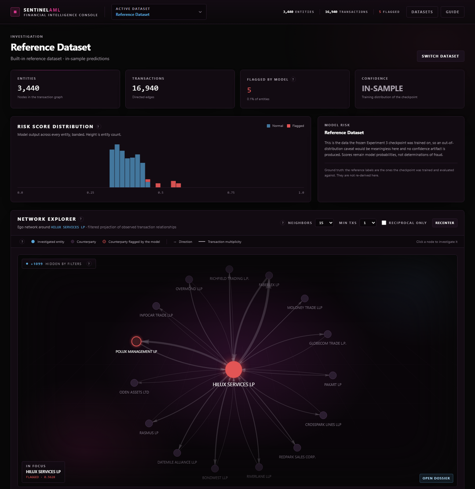
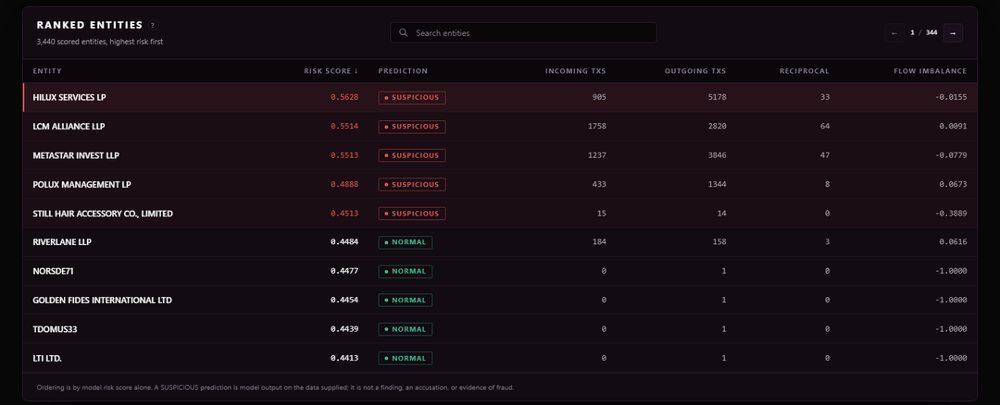
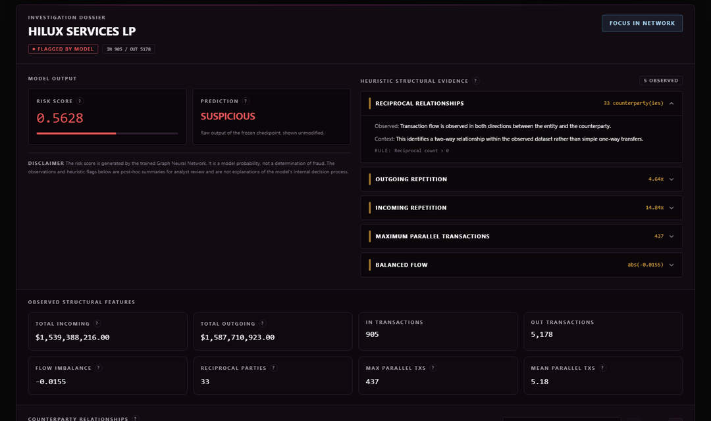

# Graph-Based Mule Account & Circular Transaction Detection

[](https://github.com/Purvaxx/mule-account-detection/actions/workflows/tests.yml)


[](LICENSE)

An anti-money-laundering project. Transactions are turned into a directed graph,
every account gets a risk score, and a dashboard shows why an account was flagged.



## Highlights

- **Pipeline:** transactions are loaded, each counterparty is matched to a single
  entity, and the result is built into a directed multigraph. Repeated transfers
  between the same two accounts are kept as separate edges, not merged. 167
  features are computed for each account and a GraphSAGE model scores them.
- **Benchmark:** on IBM AMLworld HI-Small (5.1M transactions, 515K accounts),
  gradient boosting on six groups of AML features reaches an average precision
  of 0.38. A baseline that never looks at the labels gets 0.039, so this is about
  9.8 times better.
- **Graph features did not help:** I tested whether graph features add anything
  over plain tabular features, using a split where the model only sees the past.
  They gave no measurable improvement, so I did not build a bigger GNN. The full
  comparison is in [`docs/model_selection.md`](docs/model_selection.md).
- **Your own data:** any CSV or Excel file can be uploaded. Each column is
  matched to the expected schema with the evidence shown, and a compatibility
  check decides whether the data is allowed to reach the model.
- **Reproducible:** every experiment runs from a config file, is checked for data
  leakage automatically, and is repeated over several random seeds. 918 tests
  run in CI on every push.
- **Works offline:** the dashboard has a network explorer, a ranked list of
  entities and an evidence page for each one. The front-end libraries are
  included in the repo, so no internet connection is needed.

| Ranked entities | Investigation dossier |
|---|---|
|  |  |

## Quick start

```bash
git clone https://github.com/Purvaxx/mule-account-detection.git
cd mule-account-detection
pip install -r requirements.txt

# Reference Dataset: download dkdata.json from the v1.0.0 release, one level up
gh release download v1.0.0 --repo Purvaxx/mule-account-detection --pattern dkdata.json --dir ..

python run_ui.py        # dashboard at http://127.0.0.1:8080 (about a minute to start)
python -m pytest        # full test suite
```

Without the `gh` CLI, download `dkdata.json` from the
[v1.0.0 release page](https://github.com/Purvaxx/mule-account-detection/releases/tag/v1.0.0)
and save it next to the cloned folder.

## Project status

> **Status note.** This README describes what the repository does **today**.
> Anything not yet working is listed under
> [Current limitations](#current-limitations) rather than described as finished. See `docs/decisions.md` for why each design choice
> was made and `docs/architecture.md` for the full layered specification.

> **Product direction (2026-09-11).** The target system is an **ML +
> investigation-intelligence hybrid**: a model ranks entities by suspicious
> behaviour observed in an analysis window, and graph / temporal analytics
> (cycles, flows, counterparties) explain each alert without changing its score.
> On the one dataset that can rank models (IBM AMLworld HI-Small, synthetic),
> gradient boosting on six AML feature families reaches AP 0.3827 for
> *retrospective* detection; *forecasting* future involvement is weak, and graph
> features add little to either - so no GNN is built. Every score now travels
> in a model-independent contract (`src/detection/contract.py`). The frozen
> GraphSAGE below is the model the dashboard still serves; it is a legacy
> regression reference, not a validated detector. See
> `docs/system_architecture_decision.md`.

---

## What the system currently does

On the **Reference Dataset**, end to end and verified:

1. Ingests transaction records and validates them against a fixed canonical schema.
2. Resolves each counterparty to a canonical entity (by normalized name, by default).
3. Builds an authoritative `networkx.MultiDiGraph` — directed, with parallel edges
   preserved rather than collapsed.
4. Computes **167 model features**: 160 baseline structural/categorical features
   plus 7 directed-multigraph features.
5. Runs inference with the **frozen Experiment 3 GraphSAGE checkpoint** and emits a
   risk score and predicted class per entity.
6. Serves an investigation dashboard with entity ranking, evidence, and an
   interactive network explorer.

It also analyses **external datasets** end to end via the workspace subsystem —
upload, structural profiling, semantic column mapping with explainability,
canonicalization, compatibility validation against the frozen model contract,
and inference with persisted predictions. Three real external datasets are run
through this path in `tests/test_real_datasets.py`: one reaches `READY` /
`DEGRADED`, and two are `BLOCKED` at compatibility validation on a missing USD
amount. None of them establishes model validity — see
[Current limitations](#current-limitations) and `docs/workspaces.md` →
*Verified external dataset results*.

Ground-truth labels are **not** required: an unlabelled dataset reaches READY
and is scored. See [Current limitations](#current-limitations) for what a
dataset genuinely must supply.

---

## The Reference Dataset

The Reference Dataset is the project's primary regression anchor. Every
architectural claim in this repository is validated against it.

| Property | Value |
|---|---|
| Entities (graph nodes) | 3,440 |
| Transactions (graph edges) | 16,940 |
| Labelled core entities | 4 |
| Identity resolution | normalized counterparty name |
| Location | `../dkdata.json` — **outside** the repository |

The dataset is **not vendored**. All scripts, `UIConfig.DATASET_PATH`, and
`tests/test_reference_regression.py` reference it as `../dkdata.json`, i.e. one
level above the repository root. It is derived from the
public Azerbaijani Laundromat (OCCRP) data and is attached to the
[v1.0.0 release](https://github.com/Purvaxx/mule-account-detection/releases/tag/v1.0.0)
as `dkdata.json`; place it at that path before running the demo, the dashboard
or the reference tests (see `docs/datasets.md`).

Its behaviour is pinned to exact values:

```text
3,440 entities
HILUX SERVICES LP     risk 0.56275397  class 1
LCM ALLIANCE LLP      risk 0.55135107  class 1
METASTAR INVEST LLP   risk 0.55129605  class 1
```

Any change that moves these numbers is a regression, not an improvement.

> **Scientific caveat.** The Experiment 3 configuration achieves perfect
> separation on this dataset, driven almost entirely by `reciprocal_out_count`.
> With only 4 positive entities, this is **not** evidence of generalizable
> real-world AML performance and must not be presented as such. See
> `docs/architecture.md` §28.3.

---

## Requirements

Python 3.11. Clone the repository and install dependencies:

```bash
git clone https://github.com/Purvaxx/mule-account-detection.git
cd mule-account-detection
python -m venv .venv
.venv\Scriptsctivate          # Windows; on macOS/Linux: source .venv/bin/activate
pip install -r requirements.txt
```

Then place the Reference Dataset at `../dkdata.json` (see
[The Reference Dataset](#the-reference-dataset)).

`requirements.txt` declares every runtime and test dependency: `pandas`,
`numpy`, `networkx`, `torch` (CPU build), `torch-geometric`, `scikit-learn`, a
parquet engine (`fastparquet`; `pyarrow` also satisfies pandas and takes
precedence when both are installed), `openpyxl` and `xlrd` for `.xlsx` / `.xls`
uploads, and `pytest` / `requests` for the suite.

The frozen checkpoint must exist at `artifacts/models/experiment3_graphsage.pt`.
It is committed to the repository.

The dashboard's three front-end libraries — Tailwind, Alpine.js and
Vis-Network — are committed under `src/ui/vendor/` and served by the local
server, so **the console needs no internet access to run**. See
`src/ui/vendor/README.md` for the pinned versions and their checksums.

---

## How to run it

All commands run from the repository root.

### Headless inference on the Reference Dataset

```bash
python run_demo.py
```

Prints ranked entity risk scores. This is the fastest way to confirm the pipeline
and checkpoint are intact.

### Interactive dashboard

```bash
python run_ui.py
```

Serves at `http://127.0.0.1:8080`. The server loads and scores the Reference
Dataset at startup and exits if the checkpoint is missing. Normal UI operation
**never** trains a model. No internet access is required: the front-end
libraries are served from `src/ui/vendor/`.

Startup takes roughly a minute — it ingests the Reference Dataset, builds the
graph, computes all 167 features and runs the checkpoint before it binds the
port. Wait for `Serving AML Dashboard at ...` before opening the browser.

### A first walkthrough

Once the dashboard is up, this is the whole system in about five minutes:

1. **Reference Dataset** loads by default. The four cards read entities,
   transactions, how many the model flagged, and that these predictions are
   *in-sample* — this is the data the checkpoint was trained on.
2. **Network Explorer** — the ego network around the top-ranked entity.
   Click any counterparty node to re-centre the investigation on it.
3. **Ranked Entities** — every entity ordered by model risk. Ordering is by
   score alone; a `SUSPICIOUS` prediction is model output, not a finding.
4. **Investigation Dossier** — the selected entity's score, its observed
   structural features, and post-hoc heuristic flags that are explicitly
   labelled as *not* explanations of the model's reasoning.
5. **Datasets → Dataset Hub** — switch to an uploaded workspace. Opening
   `SAML-D raw` shows the out-of-sample story: `DEGRADED` readiness, a `LOW`
   confidence assessment, and the reason — the model flags 70% of that
   dataset's entities, so its decision threshold does not transfer.
6. **+ New Dataset** — upload a `.csv` / `.xlsx`, review the proposed semantic
   mapping and its per-column evidence, declare identity / currency /
   geography, validate, then **Run Analysis**.

Opening a large uploaded workspace for the first time rebuilds its graph and
feature matrix and can take a minute or more; the result is then cached for the
life of the server.

### Dataset audit and model experiments

```bash
python audit_datasets.py
```

Classifies every dataset this checkout can reach as `MODEL_SELECTION_READY`,
`STRUCTURAL_VALIDATION_ONLY`, `REGRESSION_ONLY` or `BLOCKED`, writing one JSON
per dataset to `outputs/audits/` and a table to `docs/dataset_audit_table.md`.
The interpretation is `docs/datasets.md`. The model-selection benchmark is
**`ibm_aml_hi_small`** (IBM AMLworld HI-Small). It is a 475 MB public download
and is not committed:

```bash
python acquire_dataset.py ibm_aml_hi_small
```

That writes `data/manifests/ibm_aml_hi_small.json` — source, licence, date,
size, SHA-256 — which **is** committed. `--verify-only` hashes a manually placed
file and writes the same manifest.

```bash
python run_experiment.py configs/experiments/heuristic_floor.json
python compare_experiments.py outputs/experiments/*.json
```

`run_experiment.py` runs one or more specifications; the spec's `dataset.name`
selects the loader. `compare_experiments.py` groups artifacts by dataset
version, evaluation regime and feature scope, and renders a table. It does not
name a winner. Results and their interpretation are in
`docs/model_selection.md`.

### Tests

The full suite takes about six minutes because it constructs reference state.

```bash
python -m pytest
```

To run only the frozen-behaviour anchor (~30 seconds):

```bash
python -m pytest tests/test_reference_regression.py
```

Markers available: `fast`, `integration`, `ml`, `reference`.

---

## The frozen model contract

The Experiment 3 checkpoint is **frozen**. Its metadata is the authoritative
contract:

| Field | Value |
|---|---|
| `architecture` | `BaselineGraphSAGE` |
| `input_dim` | **167** |
| `hidden_dim` | 64 |
| `num_layers` | 2 |
| `threshold` | 0.45 |
| `seed` | 42 |
| `provenance` | Experiment 3, Fold 0 |

The 167 features are, in this exact order:

```text
  5   structural scalars    log_in_degree, log_out_degree,
                            log_total_incoming_usd, log_total_outgoing_usd,
                            flow_imbalance
  4   entity type           entity_type_{Company,Person,Invalid,unknown}
151   bank country          bank_country_* (fixed vocabulary)
───
160   baseline
  7   directed-multigraph   out/in_repeated_counterparty_ratio,
                            max/mean_parallel_edge_count,
                            parallel_temporal_dispersion,
                            reciprocal_out/in_count
───
167   total
```

`src/detection/inference.py` refuses to run unless `input_dim == 167`, the data's
feature dimension matches, and the generated feature name list is **exactly
equal, including order**, to the checkpoint's `feature_names`.

**Do not change** the model architecture, checkpoint, feature ordering, graph
semantics, or inference mathematics without an explicit superseding decision
record and a retrain.

### Fixed feature vocabulary

The `bank_country_*` and `entity_type_*` vocabularies are **frozen constants** in
`src/features/baseline.py`, not derived from whatever dataset is being processed.
They were previously generated dynamically from observed country categories; that
made feature width and order a function of the input data, which is structurally
incompatible with a fixed-width trained model. See
`docs/decisions.md` → *Replace the Dataset-Derived Country Vocabulary*.

Out-of-vocabulary policy:

* **Unseen country codes are ignored** — they set no column and contribute no
  signal. There is no "other" bucket, because the checkpoint has no such column.
* **Unseen entity types map to `entity_type_unknown`**, which does exist in the
  checkpoint.

---

## External dataset workspaces

A **Workspace** is an isolated, UUID-addressed directory holding one external
dataset analysis session, persisted to disk and recoverable across restarts.

**Supported upload formats: `.csv`, `.xlsx`, `.xls` only.** Multi-sheet workbooks
and empty files are rejected. Uploads are preserved byte-for-byte and SHA-256
hashed. Profiling reads a bounded row sample (default 1000) to avoid OOM.

The pipeline is:

```text
upload → profile (structure) → semantic mapping (review) → canonicalize
       → compatibility report → READY → Run Analysis
       → fixed 167-feature encoding → frozen model → persisted predictions
       → workspace dashboard
```

All stages are working: workspace creation, isolation and path safety, upload
and hashing, atomic manifest persistence, crash recovery, structural profiling,
the confidence-scored semantic mapper with retained evidence, canonicalization,
compatibility validation, and workspace inference with persisted predictions.

Run an analysis with `POST /api/workspaces/<id>/predict`, or the **Run Analysis**
button in the Dataset Hub. Compatibility `READY` means *eligible to analyse* —
it does not mean predictions exist; those appear only after a run.

Full detail: `docs/workspaces.md`.

---

## Current limitations

**Arbitrary external datasets can now run inference**, provided they satisfy the
inference contract. The end-to-end path — upload → profile → mapping →
canonicalization → compatibility → READY → Run Analysis → persisted predictions
→ dashboard — is delivered, and is exercised against three real external
datasets in `tests/test_real_datasets.py`. Only one of them reaches `READY`:
the Azerbaijani Laundromat (OCCRP) raw workbook, at `readiness = DEGRADED`. It
is **not** independent evidence of model validity, because the frozen checkpoint
was trained on that data. SAML-D as published and IBM AML are both
`INCOMPATIBLE` / `BLOCKED`, on `missing_required_fields == ["amount_usd"]`.

What a dataset must supply to reach `READY`:

* a timestamp and a USD amount (`date`, `amount_usd`);
* an identity: either both name columns (`NAME`) or both account columns
  (`ACCOUNT_ID`).

What it does **not** need:

* **ground-truth labels** — `payer_core`, `beneficiary_core`, `investigation`
  are the model's prediction target and analyst metadata. The 167 features
  consume none of them. Unlabelled datasets are fully supported.
* entity type or bank country — these degrade to `entity_type_unknown` and a
  zeroed country block. The vector stays exactly 167 wide in the trained order,
  and the degradation is reported as a warning.
* any other canonical metadata.

Real limitations that remain:

* **No FX conversion.** A dataset whose amounts are in mixed currencies cannot
  reach `READY`. `CurrencyPolicy.EXTERNAL_FX_REQUIRED` is honestly reported as
  `INCOMPATIBLE` rather than guessing rates. This is what blocks both the raw
  IBM AML dataset, whose 137,936 rows span 15 currencies with only 42% USD, and
  SAML-D as published, which states a `Payment_currency` but carries no USD
  amount column.
* **Geography outside the frozen vocabulary still carries no signal.** Country
  *notations* are now resolved into the frozen 151-code vocabulary under stated
  rules — `"United Kingdom"`, `"UK"`, `"GBR"` and `"gb"` all reach the model as
  `GB`. But a country the checkpoint has no column for (`Morocco`, `USA`,
  `Japan`) cannot be represented at all. Such values are left exactly as
  supplied — never bucketed or substituted — and reported per column.
* **No distribution check against training data.** A `READY` report always
  carries the standing warning that the dataset has not been statistically
  tested against the training baseline, and every run now carries a confidence
  assessment built from observed run facts (alert rate, empty feature blocks,
  label availability). Its ceiling is `UNVERIFIED`: nothing available at
  inference time can establish that a frozen model transfers to an unseen
  dataset. **An enriched SAML-D copy — carrying this project's own canonical
  columns, not the published dataset, which is `BLOCKED` — does reach `READY`,
  flags ~70% of its entities, and is reported at confidence `LOW`. Its scoring
  is not evidence of model validity.**
* **`WorkspaceStatus.PARTIAL`** is honoured as a blocker but never produced.
* **Only node classification feeds the model.** The 167 features and the
  frozen checkpoint are a node classifier; causal temporal prediction and TDA
  remain research code and audits, not part of the shipped inference path.
  Cycle detection is delivered as *post-hoc investigator evidence* over the
  same graph the predictions were computed from — `src/detection/cycles.py`,
  served at `GET /api/cycles` and `GET /api/cycles/{cycle_id}` — and is
  strictly downstream of inference: nothing in it participates in
  `risk_score`, `predicted_class`, the 167-feature representation,
  compatibility status or the trust assessment. **It has no user interface
  yet**; it is reachable only through the API.
* **Entity labels for `NAME`-mode uploads are the normalized key.** Identity
  resolution lowercases and strips a counterparty name to a single token
  (`"Demo Entity 06 Ltd"` → `demoentity06ltd`), and the dashboard displays
  that key, because no representative original name is carried through
  canonicalization. The Reference Dataset is unaffected — its source supplies
  readable `*_name_norm` values — and `ACCOUNT_ID` workspaces are unaffected.
* **A large workspace takes minutes to open the first time.** Opening an
  uploaded workspace rebuilds its graph and 167-feature matrix in-process
  (~90s for the 100,000-transaction / 65,168-entity SAML-D workbook). The
  result is cached for the life of the server, so the second open is
  immediate. The console stays loadable while this runs, but its data views
  wait for it.

## Repository layout

```text
mule-account-detection/
├── README.md                  This file
├── LICENSE                    MIT licence
├── artifacts/models/          Frozen Experiment 3 checkpoint
├── configs/experiments/       One JSON specification per experiment
├── data/manifests/            Provenance for externally acquired datasets
├── docs/
│   ├── architecture.md        Full layered architecture specification
│   ├── datasets.md            Dataset audit: what each dataset may be used to claim
│   ├── dataset_audit_table.md Generated audit table (do not edit by hand)
│   ├── decisions.md           Architectural decision records
│   ├── model_selection.md     Baseline results, ablations, advanced-model decision
│   ├── research.md            Research findings grounded in this repository
│   ├── UI_ARCHITECTURE.md     Presentation layer and redesign contract
│   └── workspaces.md          External dataset workspace architecture
├── src/
│   ├── data/                  Ingestion, validation, entity resolution
│   ├── datasets/              Workspaces, profiling, mapping, canonicalization
│   ├── experiments/           Layer 6: model-agnostic experiments and dataset audit
│   ├── features/              baseline (160) · multigraph (7) · temporal · tda
│   ├── graph/                 MultiDiGraph construction
│   ├── models/                GraphSAGE, PyG dataset, trainer
│   ├── detection/             Risk contract + engines, frozen-checkpoint inference, explanation, cycles
│   └── ui/                    HTTP server, adapter, resolver, frontend
│       └── vendor/            Tailwind, Alpine, Vis-Network (committed, no CDN)
├── tests/
├── outputs/
│   ├── audits/                Machine-readable dataset audits
│   └── experiments/           Machine-readable experiment artifacts
├── run_demo.py                Headless inference
├── run_ui.py                  Dashboard
├── run_experiment.py          Run experiment specifications
├── acquire_dataset.py         Fetch a published benchmark + write its manifest
├── audit_datasets.py          Audit every reachable dataset
├── compare_experiments.py     Group and render experiment artifacts
├── calendar_design_audit.py   Calendar-forward split design audit
└── scripts/legacy/            Historical Experiment 1-5 runs and research audits
                               (run from the repo root: python -m scripts.legacy.run_exp1)
```

`data/raw/` and `data/processed/` are local-only and not committed. The
benchmark datasets are not vendored: they are large public downloads, and
`audit_datasets.py` reports which of them this checkout can actually reach.

---

## Documentation

| Document | Purpose |
|---|---|
| `docs/architecture.md` | Layered architecture, feature definitions, experimental design and results |
| `docs/datasets.md` | Which datasets exist, what each can support, and why no current dataset can rank models |
| `docs/model_selection.md` | Baseline and ablation results, the label-free floor, and the advanced-model GO/NO-GO |
| `docs/decisions.md` | Architectural decision records with status |
| `docs/research.md` | Research findings grounded in this repository's own experiments |
| `docs/workspaces.md` | External dataset workspace architecture and current state |
| `docs/UI_ARCHITECTURE.md` | Presentation layer boundary and redesign contract |
| `docs/system_architecture_decision.md` | What the system optimises for, the role of ML and graph analytics, the production contract, the research roadmap |
| `docs/calendar_forward_benchmark.md` | The forecasting benchmark and the graph NO-GO |
| `docs/temporal_collapse.md` | Why the survivorship time-forward split misled |

When source and documentation disagree, **the source and its tests win**.

---

## License

Released under the [MIT License](LICENSE). The bundled front-end libraries in
`src/ui/vendor/` (Tailwind CSS, Alpine.js, Vis-Network) keep their own open-source licences, and
the datasets referenced here remain under their publishers' terms.
